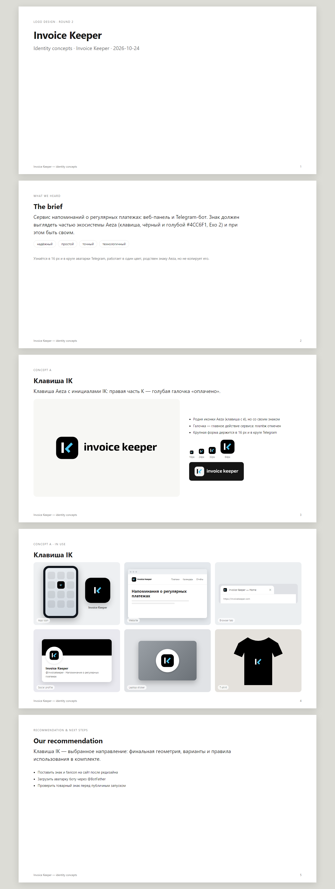

# Логотип Invoice Keeper — «Клавиша IK»

Знак сделан в визуальном языке гайдбука Aéza 2026 (клавиша, чёрный + светло-голубой, Exo 2), но это **свой знак**, а не изменённый логотип Aéza.

**Идея:** клавиша с инициалами I и K, где правая часть K — голубая галочка «оплачено». Платёж отмечен — главное действие сервиса.

## Что в комплекте

| Папка / файл | Что это |
|---|---|
| `svg/ik-symbol.svg` | Основной знак: чёрная клавиша, белая I, голубая галочка. Для светлых, голубых и тёмно-синих фонов |
| `svg/ik-symbol-dark.svg` | Для чёрных и почти чёрных фонов (тёмная тема): светлая клавиша #F4F4F4, чёрная I |
| `svg/ik-symbol-small.svg`, `-small-dark.svg` | Версия для 32 px и меньше: толще штрихи, крупнее буквы, шире зазор |
| `svg/ik-symbol-mono-black.svg`, `-mono-white.svg` | Один цвет: буквы вырезаны из клавиши (печать, гравировка, штамп) |
| `svg/ik-glyph-*.svg` | Буквы без клавиши: `color` на светлом, `reversed` на чёрном, `black` / `white` в один цвет |
| `svg/ik-lockup-horizontal*.svg` | Знак + название в строку (основной вариант для шапки сайта) |
| `svg/ik-lockup-stacked*.svg` | Знак над названием (экраны входа, обложки) |
| `svg/ik-wordmark-*.svg` | Только название |
| `svg/ik-telegram-avatar.svg`, `telegram/*.png` | Аватарка бота, 640 и 512 px |
| `web/` | `favicon.ico` (16/32/48), `favicon.svg`, `apple-touch-icon.png`, `icon-192/512.png`, `icon-maskable-512.png`, `site.webmanifest`, `head-snippet.html` |
| `png/` | Растровые копии знака (1024, 256) и подписей (1200 / 800 px), прозрачный фон |
| `presentation.html` / `.png` | Презентация с макетами: иконка приложения, сайт, вкладка, соцсети, стикер, футболка |
| `concepts-round2.png` | Три концепта, из которых выбран этот |

Все SVG без живого текста, растров, фильтров и масок; название переведено в контуры.

## Построение

- Поле 256 × 256, клавиша 240 × 240, скругление **25 % стороны** — как у клавиш Aéza.
- Буквы занимают **47 % высоты клавиши** (как «é» в знаке Aéza), подняты на 2 единицы для оптического центра.
- Штрих 26 из 240 (≈ 11 %); плечи галочки — ровно ±45°; длинное плечо заканчивается на линии верха I, короткое — на линии низа.
- Мелкая версия: штрих 36, буквы 142 из 240, зазор между I и K 16.

## Цвета

| Цвет | HEX | RGB | CMYK | Pantone | Роль |
|---|---|---|---|---|---|
| Чёрный | `#000000` | 0 0 0 | 0 0 0 100 | Black C | клавиша, текст |
| Голубой | `#4CC6F1` | 76 198 241 | 68 18 0 5 | 298 C | галочка — единственный акцент |
| Светло-серый | `#F4F4F4` | 244 244 244 | 0 0 0 4 | Cool Gray 1 C | клавиша на тёмном фоне, подложки |
| Белый | `#FFFFFF` | 255 255 255 | 0 0 0 0 | — | буква I на чёрной клавише |

Значения взяты из гайдбука Aéza (раздел «Основные цвета»).

## Какой вариант где

- **Светлый фон, #F4F4F4, голубой #4CC6F1, тёмно-синий #182D48** → `ik-symbol` / `ik-lockup-horizontal`.
- **Чёрный фон, тёмная тема сайта** → `ik-symbol-dark` / `ik-lockup-horizontal-dark`.
- **Меньше 32 px** (favicon, плотные списки) → `ik-symbol-small`.
- **Один цвет** → `mono-black` / `mono-white`.
- **Аватарка Telegram** → `telegram/ik-telegram-avatar-640.png` (Telegram сам обрежет в круг; буквы стоят внутри вписанного круга с запасом).

## Охранное поле и минимальные размеры

- Охранное поле — **¼ стороны клавиши** (равно радиусу скругления) со всех сторон. В нём нет текста и графики.
- Знак: от **16 px** (до 32 px — только мелкая версия).
- Подпись в строку: высота клавиши от **24 px**.
- Название набрано **Exo 2 Bold**, строчными, трекинг −1 %. В интерфейсе название можно набирать живым текстом Exo 2; в самом логотипе — только контуры из этого комплекта.

## Как нельзя

- Менять цвета местами (голубая I, белая галочка) или красить клавишу в голубой.
- Отделять галочку от I, поворачивать, растягивать, менять скругление клавиши.
- Добавлять тени, обводки, градиенты, свечение.
- Ставить знак рядом с клавишами Aéza так, будто это одно слово, или использовать логотип Aéza вместо этого знака.
- Ставить основную (чёрную) клавишу на чёрный фон — для него есть `ik-symbol-dark`.

## Подключение на сайт

`web/head-snippet.html` — готовые теги для `<head>`; файлы из `web/` кладутся в `frontend/public/`. Компонент `Logo` берёт `svg/ik-symbol.svg` (светлая тема) и `svg/ik-symbol-dark.svg` (тёмная) или те же пути inline с токенами `--brand-key` / `--brand-key-fg`.

## Проверено и открытые вопросы

- Проверено рендером: 16 / 24 / 32 / 64 px на светлом и тёмном фоне, круг Telegram, маскируемая иконка, макеты.
- Товарный знак не проверялся — нужен поиск по базам перед публичным запуском.
- Знак заметно опирается на стиль Aéza; вне хакатона это стоит согласовать с Aéza.
- Exo 2 — лицензия SIL OFL 1.1, использование в логотипе разрешено.
